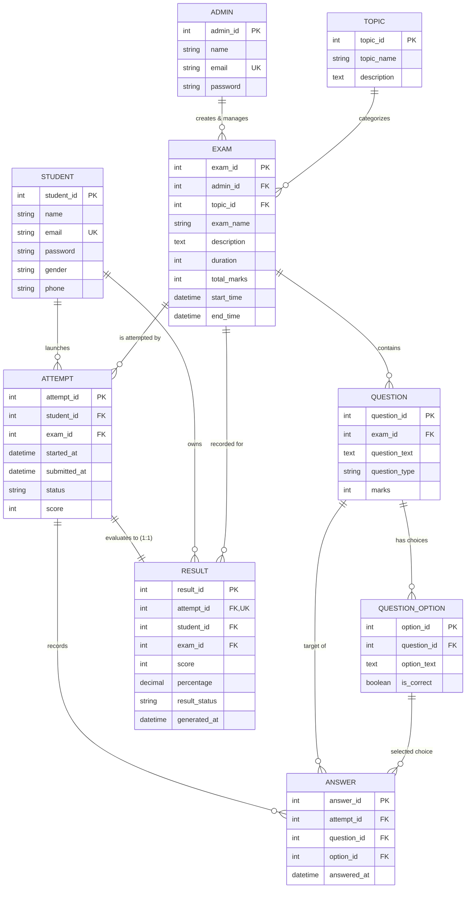

# Online Competitive Exams Platform

[](https://nodejs.org/)
[](https://react.dev/)
[](https://vitejs.dev/)
[](https://expressjs.com/)
[](https://dev.mysql.com/)
[](https://jwt.io/)
[](https://helmetjs.github.io/)
[](LICENSE)

An enterprise-grade, full-stack online examination and testing engine designed for educational institutions, testing centers, and competitive assessment programs. It features timed examination environments, automated grading, tie-breaking dynamic rankings, comprehensive administrative consoles, and candidate performance analytics.

---

## Table of Contents

1. [System Architecture](#system-architecture)
2. [Database Design & ER Model](#database-design--er-model)
   - [Entity Relationship Diagram](#entity-relationship-diagram)
   - [Table Schemas & Constraints](#table-schemas--constraints)
   - [Core SQL Queries](#core-sql-queries)
3. [Business Logic & Evaluation Engine](#business-logic--evaluation-engine)
   - [Attempt Lifecycle](#attempt-lifecycle)
   - [Scoring & Pass/Fail Algorithm](#scoring--passfail-algorithm)
   - [Ranking & Tie-Breaking Formulation](#ranking--tie-breaking-formulation)
4. [User Journeys & Features](#user-journeys--features)
   - [Candidate (Student) Experience](#candidate-student-experience)
   - [Administrative Control Center](#administrative-control-center)
5. [Complete REST API Specification](#complete-rest-api-specification)
   - [Authentication Endpoints](#1-authentication-endpoints)
   - [Student Examination Endpoints](#2-student-examination-endpoints)
   - [Results & Leaderboard Endpoints](#3-results--leaderboard-endpoints)
   - [Administrator Endpoints](#4-administrator-endpoints)
6. [Monorepo Directory Structure](#monorepo-directory-structure)
7. [Getting Started & Installation](#getting-started--installation)
   - [Prerequisites](#prerequisites)
   - [Configuration (.env)](#configuration-env)
   - [Running the Project](#running-the-project)
8. [Default Demo Accounts](#default-demo-accounts)
9. [Security Architecture](#security-architecture)
10. [License](#license)

---

## System Architecture

The platform operates as a modern decoupled full-stack application configured within an npm workspace monorepo:

```
┌────────────────────────────────────────────────────────────────────────┐
│                        CLIENT LAYER (SPA)                              │
│  React 19 • Vite 8 • React Router 7 • Lucide Icons • Design Tokens     │
│  Axios HTTP Client with Bearer Token Interceptor & Auto-401 Routing    │
└───────────────────────────────────┬────────────────────────────────────┘
                                    │ HTTP / REST (JSON)
                                    ▼
┌────────────────────────────────────────────────────────────────────────┐
│                        BACKEND API LAYER                               │
│  Express 5 • Helmet Security Headers • CORS Middleware • Bcrypt Hash   │
│  JWT Stateless Session Auth • Error Handling Middleware Pipeline       │
├───────────────────────────────────┼────────────────────────────────────┤
│           CONTROLLERS             │          CORE SERVICES             │
│  authController   studentController│  evaluationService (Scoring &     │
│  examController   questionController│  transactions with FOR UPDATE    │
│  attemptController resultController│  locks)                           │
│  adminController  topicController  │                                   │
└───────────────────────────────────┬────────────────────────────────────┘
                                    │ Parameterized SQL Pool
                                    ▼
┌────────────────────────────────────────────────────────────────────────┐
│                        DATABASE LAYER                                  │
│  MySQL 8.0+ / SQLite 3 Driver (mysql2 & node:sqlite compatibility)     │
│  9 Relational Entities • Strict UNIQUE Constraints • Cascading Deletes │
└────────────────────────────────────────────────────────────────────────┘
```

---

## Database Design & ER Model

The underlying relational schema consists of **9 tables** structured to enforce strict referential integrity, prevent duplicate submissions, ensure idempotency, and eliminate orphaned records via cascading deletes.

### Entity Relationship Diagram



### Table Schemas & Constraints

| Table | Primary Key | Foreign Keys | Key Constraints & Indexes | Description |
| :--- | :--- | :--- | :--- | :--- |
| **`admin`** | `admin_id` (INT AI) | None | `email` (UNIQUE) | Authorized exam authors and administrators. |
| **`student`** | `student_id` (INT AI) | None | `email` (UNIQUE) | Registered student / candidate user accounts. |
| **`topic`** | `topic_id` (INT AI) | None | None | Categorical subjects (e.g., Computer Science, Aptitude). |
| **`exam`** | `exam_id` (INT AI) | `admin_id`, `topic_id` | `ON DELETE CASCADE` | Core exam definitions, duration (mins), total marks, and schedule. |
| **`question`** | `question_id` (INT AI) | `exam_id` | `ON DELETE CASCADE` | Questions linked to an exam; specifies mark values. |
| **`question_option`**| `option_id` (INT AI) | `question_id` | `ON DELETE CASCADE` | Multiple-choice options. Contains `is_correct` boolean. |
| **`attempt`** | `attempt_id` (INT AI) | `student_id`, `exam_id` | `UNIQUE(student_id, exam_id)` | Active test session. Ensures a student can only take an exam once. |
| **`answer`** | `answer_id` (INT AI) | `attempt_id`, `question_id`, `option_id` | `UNIQUE(attempt_id, question_id)` | Selected options. Ensures selecting a new option updates the row. |
| **`result`** | `result_id` (INT AI) | `attempt_id`, `student_id`, `exam_id` | `attempt_id` (UNIQUE) | Graded results with percentage and pass/fail status. Strict 1:1 with attempt. |

### Core SQL Queries

The engine uses raw parameterized SQL queries for optimal performance:

```sql
-- 1. Fetch live rank using SQL Window Functions with tie-breaking
SELECT 
    RANK() OVER (ORDER BY a.score DESC, a.submitted_at ASC) as `rank`,
    s.student_id,
    s.name as student_name,
    a.score,
    ROUND((CAST(a.score AS FLOAT) / e.total_marks) * 100, 2) as percentage
FROM attempt a
JOIN student s ON a.student_id = s.student_id
JOIN exam e ON a.exam_id = e.exam_id
WHERE a.exam_id = ? AND a.status = 'SUBMITTED';

-- 2. Upsert / safe overwrite of student answers during an active session
INSERT INTO answer (attempt_id, question_id, option_id, answered_at)
VALUES (?, ?, ?, NOW())
ON DUPLICATE KEY UPDATE 
    option_id = VALUES(option_id),
    answered_at = NOW();

-- 3. Topic-wise examination distribution
SELECT t.topic_id, t.topic_name, COUNT(e.exam_id) as total_exams
FROM topic t
LEFT JOIN exam e ON t.topic_id = e.topic_id
GROUP BY t.topic_id, t.topic_name;
```

---

## Business Logic & Evaluation Engine

### Attempt Lifecycle

```
[Student starts test] ──> INSERT INTO attempt (status = 'IN_PROGRESS', started_at = NOW())
                                │
                                ▼
                       Candidate answers questions
                       (Recorded into answer table)
                                │
                                ▼
[Student clicks submit OR timer reaches 00:00]
                                │
                                ▼
                       BEGIN TRANSACTION
                       SELECT ... FOR UPDATE (Lock attempt row)
                                │
                                ▼
                       Execute evaluateAttempt()
                                │
                                ▼
                       UPDATE attempt SET status = 'SUBMITTED', submitted_at = NOW(), score = ?
                       INSERT INTO result (attempt_id, score, percentage, result_status)
                                │
                                ▼
                       COMMIT TRANSACTION
```

### Scoring & Pass/Fail Algorithm

The automated grading service iterates over the examination questions and compares the candidate's chosen option with the verified answer key:

$$\text{Final Score} = \sum_{\substack{q \in \text{Questions} \\ \text{selected\_option}(q) = \text{correct\_option}(q)}} \text{marks}(q)$$

$$\text{Percentage} = \left( \frac{\text{Final Score}}{\text{Exam Total Marks}} \right) \times 100$$

$$\text{Result Status} = \begin{cases} \text{"PASS"}, & \text{if Percentage} \ge 50.0\% \\ \text{"FAIL"}, & \text{if Percentage} < 50.0\% \end{cases}$$

### Ranking & Tie-Breaking Formulation

Rankings are computed dynamically using standard window functions. When candidates achieve identical scores, ties are resolved deterministically by submission speed:
1. **Primary criterion**: `score DESC` (higher score earns higher rank).
2. **Secondary tie-breaker**: `submitted_at ASC` (candidate who submitted earliest earns higher rank).

---

## User Journeys & Features

### Candidate (Student) Experience

- **Onboarding (`/login`, `/register`)**:
  - Secure registration and login with email & password.
  - Quick-fill demo button (`student1@example.com` / `password123`) for rapid testing.
  - Password visibility toggle and form validation.
- **Candidate Dashboard (`/student/dashboard`)**:
  - Personalized welcome greeting.
  - KPI Stat Cards: Completed Exams, Passed Tests, and Average Accuracy.
  - Recommended Exams carousel with duration and marks chips.
  - Recent performance history table.
- **Exam Catalog & Detail View (`/student/exams`, `/student/exams/:id`)**:
  - Searchable list of all active examinations.
  - Filter by Subject Topic tabs (Mathematics, CS, Reasoning, etc.).
  - Detailed pre-exam briefing: time limit, total questions, maximum marks, passing score rules, and readiness checklist.
- **Live Examination Room (`/student/exam/:attemptId`)**:
  - Distraction-free full-viewport layout.
  - Prominent monospace tabular countdown timer (`MM:SS`). Single-fire guard prevents duplicate auto-submissions on expiration.
  - Question Navigator palette:
    - **Answered** (Green badge)
    - **Marked for Review** (Amber bookmark icon)
    - **Unvisited / Unanswered** (Neutral slate)
  - Interactive multiple-choice options (A, B, C, D) with immediate answer caching.
  - Pre-submission confirmation modal showing total answered, review, and remaining questions before submission.
- **Performance Scorecard (`/student/results/:id`)**:
  - Circular progress gauge with color-coded PASS/FAIL badge.
  - Summary metrics: Marks Scored, Total Available Marks, and Generated Date.
  - Direct CTA to view the examination leaderboard.
- **Competitive Leaderboard (`/student/ranking/:examId`)**:
  - Top 3 Podium Cards: **1st Place** (Gold / Crown), **2nd Place** (Silver), **3rd Place** (Bronze).
  - Searchable standings table with candidate initials, scores, and percentages.
  - The logged-in candidate is automatically highlighted with a **"You"** badge.

### Administrative Control Center

- **Admin Login (`/admin/login`)**:
  - Dedicated administrative portal with credentials quick-fill (`admin1@example.com` / `password123`).
- **Overview Dashboard (`/admin/dashboard`)**:
  - 6 Real-time KPI stat cards: Registered Candidates, Active Examinations, Subject Topics, Question Bank Items, Total Attempts, and Completed Submissions.
  - Quick action bar: New Exam, Manage Questions, Manage Topics, View Candidates.
  - Side-by-side feeds for Active Examinations and Recent Test Submissions.
- **Candidate Directory (`/admin/students`)**:
  - Real-time search by candidate name, email, or telephone.
  - **Candidate Profile & History Modal**: View complete attempt audit logs (exams taken, scores, statuses, and start/submission dates) for any student.
- **Topic Management (`/admin/topics`)**:
  - Grid card presentation of all academic subject topics.
  - Create & Edit Modal (`topic_name`, `description`).
  - Referential integrity check: deletion modal protects topics associated with active exams.
- **Examination Management (`/admin/exams`)**:
  - Filter by topic, search by exam title.
  - Create / Edit modal with datetime inputs for availability windows.
  - Direct shortcut button to immediately manage the exam's questions.
  - Safe custom deletion confirmation modal.
- **Question Repository (`/admin/questions`)**:
  - Examination selector dropdown showing total questions added and cumulative marks configured versus total exam marks.
  - Multiple-choice authoring modal: question text, mark value, and dynamic answer choices with single-click correct answer radio selection.
  - Full preview cards showing verified correct answer indicators.
- **Attempt Telemetry & Audit (`/admin/attempts`)**:
  - Audit log tracking attempt IDs, candidate names, exam names, started-at timestamps, submitted-at timestamps, and status badges (`IN_PROGRESS` vs `SUBMITTED`).
- **Results Analytics (`/admin/results`)**:
  - Institution-wide grade book with scorecards, accuracy percentages, pass rate calculations, and outcome filtering.

---

## Complete REST API Specification

All protected routes require the HTTP header:
`Authorization: Bearer <jwt_token>`

### 1. Authentication Endpoints

#### Register Student
- **Endpoint**: `POST /api/auth/student/register`
- **Payload**:
  ```json
  {
    "name": "Jane Doe",
    "email": "jane@example.com",
    "password": "securepassword123",
    "gender": "Female",
    "phone": "+1-555-0199"
  }
  ```
- **Response** (`201 Created`):
  ```json
  {
    "success": true,
    "message": "Student registered successfully",
    "data": { "student_id": 4 }
  }
  ```

#### Student Login
- **Endpoint**: `POST /api/auth/student/login`
- **Payload**:
  ```json
  {
    "email": "student1@example.com",
    "password": "password123"
  }
  ```
- **Response** (`200 OK`):
  ```json
  {
    "success": true,
    "message": "Login successful",
    "token": "eyJhbGciOiJIUzI1NiIsIn...",
    "data": {
      "id": 1,
      "name": "John Doe",
      "email": "student1@example.com",
      "role": "STUDENT"
    }
  }
  ```

#### Admin Login
- **Endpoint**: `POST /api/auth/admin/login`
- **Payload**:
  ```json
  {
    "email": "admin1@example.com",
    "password": "password123"
  }
  ```
- **Response** (`200 OK`):
  ```json
  {
    "success": true,
    "message": "Admin login successful",
    "token": "eyJhbGciOiJIUzI1NiIsIn...",
    "data": {
      "id": 1,
      "name": "Super Admin",
      "email": "admin1@example.com",
      "role": "ADMIN"
    }
  }
  ```

---

### 2. Student Examination Endpoints

#### Get Available Exams
- **Endpoint**: `GET /api/student/exams`
- **Headers**: `Authorization: Bearer <student_token>`
- **Response** (`200 OK`):
  ```json
  {
    "success": true,
    "data": [
      {
        "exam_id": 1,
        "topic_id": 1,
        "exam_name": "Data Structures & Algorithms Qualifier",
        "description": "Comprehensive timed test covering linked lists, trees, and graphs.",
        "duration": 60,
        "total_marks": 100,
        "start_time": "2026-10-01T00:00:00.000Z",
        "end_time": "2026-11-30T23:59:59.000Z",
        "topic_name": "Computer Science"
      }
    ]
  }
  ```

#### Start Exam Session
- **Endpoint**: `POST /api/student/exams/:examId/start`
- **Headers**: `Authorization: Bearer <student_token>`
- **Response** (`201 Created`):
  ```json
  {
    "success": true,
    "message": "Exam started",
    "data": {
      "attempt_id": 12,
      "exam_id": 1,
      "started_at": "2026-10-23T18:00:00.000Z",
      "status": "IN_PROGRESS"
    }
  }
  ```

#### Record / Update Answer
- **Endpoint**: `POST /api/student/attempts/:attemptId/answer`
- **Headers**: `Authorization: Bearer <student_token>`
- **Payload**:
  ```json
  {
    "question_id": 5,
    "option_id": 18
  }
  ```
- **Response** (`200 OK`):
  ```json
  {
    "success": true,
    "message": "Answer saved successfully"
  }
  ```

#### Final Exam Submission
- **Endpoint**: `POST /api/student/attempts/:attemptId/submit`
- **Headers**: `Authorization: Bearer <student_token>`
- **Response** (`200 OK`):
  ```json
  {
    "success": true,
    "message": "Exam submitted successfully",
    "data": {
      "score": 85,
      "total_marks": 100,
      "percentage": "85.00",
      "result_status": "PASS"
    }
  }
  ```

---

### 3. Results & Leaderboard Endpoints

#### My Examination Results
- **Endpoint**: `GET /api/results/my-results`
- **Headers**: `Authorization: Bearer <student_token>`
- **Response** (`200 OK`):
  ```json
  {
    "success": true,
    "data": [
      {
        "result_id": 9,
        "attempt_id": 12,
        "exam_id": 1,
        "exam_name": "Data Structures & Algorithms Qualifier",
        "score": 85,
        "percentage": "85.00",
        "result_status": "PASS",
        "generated_at": "2026-10-23T18:45:12.000Z"
      }
    ]
  }
  ```

#### Live Examination Leaderboard
- **Endpoint**: `GET /api/ranking/exam/:examId`
- **Response** (`200 OK`):
  ```json
  {
    "success": true,
    "data": [
      {
        "rank": 1,
        "student_id": 1,
        "student_name": "John Doe",
        "score": 90,
        "percentage": 90.0
      },
      {
        "rank": 2,
        "student_id": 3,
        "student_name": "Jane Smith",
        "score": 85,
        "percentage": 85.0
      }
    ]
  }
  ```

---

### 4. Administrator Endpoints

#### Admin Dashboard KPI Stats
- **Endpoint**: `GET /api/admin/dashboard`
- **Headers**: `Authorization: Bearer <admin_token>`
- **Response** (`200 OK`):
  ```json
  {
    "success": true,
    "data": {
      "total_students": 42,
      "total_exams": 8,
      "total_questions": 120,
      "total_topics": 6,
      "total_attempts": 65,
      "completed_attempts": 58
    }
  }
  ```

#### Topics CRUD
- `GET /api/topics` - List all subject topics
- `POST /api/topics` - Create new topic (`{ "topic_name": "Algorithms", "description": "..." }`)
- `PUT /api/topics/:id` - Update topic details
- `DELETE /api/topics/:id` - Remove topic

#### Examinations CRUD
- `GET /api/exams` - List all examinations
- `POST /api/exams` - Create exam (`{ "topic_id": 1, "exam_name": "Midterm", "duration": 60, "total_marks": 100, "start_time": "...", "end_time": "..." }`)
- `PUT /api/exams/:id` - Update exam specification
- `DELETE /api/exams/:id` - Remove exam

#### Questions CRUD
- `GET /api/questions/exam/:examId` - Fetch all questions and options for an exam
- `POST /api/questions` - Create question with choices:
  ```json
  {
    "exam_id": 1,
    "question_text": "What is the worst-case time complexity of QuickSort?",
    "marks": 2,
    "question_type": "MCQ",
    "options": [
      { "option_text": "O(N log N)", "is_correct": 0 },
      { "option_text": "O(N^2)", "is_correct": 1 },
      { "option_text": "O(N)", "is_correct": 0 },
      { "option_text": "O(log N)", "is_correct": 0 }
    ]
  }
  ```
- `PUT /api/questions/:id` - Update question text and marks
- `DELETE /api/questions/:id` - Delete question

#### Candidates & Audit Telemetry
- `GET /api/admin/students` - Candidate directory (supports `?search=query`)
- `GET /api/admin/students/:id` - Candidate profile including their complete historical attempts
- `GET /api/admin/attempts` - All test attempts with start/submit timestamps and statuses
- `GET /api/admin/results` - Complete evaluation gradebook

---

## Monorepo Directory Structure

```
Online_Competitive_Exams_Platform/
├── backend/
│   ├── database/
│   │   ├── schema.sql              # Database DDL (tables, keys, cascades)
│   │   ├── seed.sql                # Seed data for admins, students, topics, exams
│   │   └── queries.sql             # Diagnostic & reporting queries
│   ├── src/
│   │   ├── config/
│   │   │   └── db.js               # Database connection pool (MySQL/SQLite)
│   │   ├── controllers/
│   │   │   ├── adminController.js   # Overview metrics, students, attempt telemetry
│   │   │   ├── answerController.js  # Answer recording during active attempts
│   │   │   ├── attemptController.js # Attempt lifecycle & submission
│   │   │   ├── authController.js    # JWT authentication for Admin & Student
│   │   │   ├── examController.js    # Exam CRUD & catalog
│   │   │   ├── questionController.js# Question & options authoring
│   │   │   ├── rankingController.js # Leaderboard & SQL ranking calculations
│   │   │   ├── resultController.js  # Graded scorecard retrieval
│   │   │   ├── studentController.js # Student specific endpoints
│   │   │   └── topicController.js   # Subject topics CRUD
│   │   ├── middleware/
│   │   │   ├── adminMiddleware.js   # Verifies role === 'ADMIN'
│   │   │   ├── authMiddleware.js    # Verifies JWT bearer token
│   │   │   └── errorMiddleware.js   # Global express error handler
│   │   ├── routes/                  # Express route declarations
│   │   ├── services/
│   │   │   └── evaluationService.js # Transactional scoring algorithm
│   │   ├── utils/
│   │   │   └── generateToken.js     # Signed JWT generator
│   │   ├── app.js                   # Express application setup
│   │   └── server.js                # Server entry point (port 3000)
│   ├── tests/
│   │   └── app.test.js              # Integration test suite
│   ├── package.json
│   └── README.md
│
├── frontend/
│   ├── public/
│   │   └── favicon.svg              # Applet favicon
│   ├── src/
│   │   ├── components/              # Reusable UI component library
│   │   │   ├── AdminRoute.jsx       # Route guard for admin access
│   │   │   ├── AppLayout.jsx        # Responsive shell layout
│   │   │   ├── EmptyState.jsx       # Friendly zero-data screens
│   │   │   ├── ErrorMessage.jsx     # Alert banner with hairline box
│   │   │   ├── ExamCard.jsx         # Elevated card with topic & schedule
│   │   │   ├── Loading.jsx          # Lucide spinner indicator
│   │   │   ├── Modal.jsx            # Accessible modal dialog with ESC support
│   │   │   ├── Navbar.jsx           # Breadcrumbs & mobile navigation toggle
│   │   │   ├── ProtectedRoute.jsx   # Route guard for student authentication
│   │   │   ├── QuestionCard.jsx     # Test question with choice selectors
│   │   │   ├── QuestionNavigation.jsx# Interactive numbered question palette
│   │   │   ├── ResultCard.jsx       # Circular accuracy gauge & metrics
│   │   │   ├── Sidebar.jsx          # Collapsible navigation drawer
│   │   │   ├── StatCard.jsx         # Metric card with icons
│   │   │   └── Timer.jsx            # Monospace countdown timer
│   │   ├── context/
│   │   │   ├── AuthContext.jsx      # Session management provider
│   │   │   └── ToastContext.jsx     # Toast notifications provider
│   │   ├── hooks/                   # Custom application hooks
│   │   ├── pages/
│   │   │   ├── admin/               # Administrative views
│   │   │   ├── auth/                # Login & registration views
│   │   │   └── student/             # Candidate views
│   │   ├── services/                # Axios API services
│   │   ├── utils/                   # LocalStorage helpers
│   │   ├── App.jsx                  # Main router configuration
│   │   ├── index.css                # Design tokens and global CSS
│   │   └── main.jsx                 # Entry point
│   ├── index.html                   # HTML entry point with synchronized meta
│   ├── vite.config.js               # Vite build configuration
│   └── package.json
│
├── .env.example                     # Environment variables template
├── package.json                     # Monorepo root configuration & scripts
└── README.md                        # Master project documentation
```

---

## Getting Started & Installation

### Prerequisites
- **Node.js**: `v20.0.0` or higher
- **npm**: `v9.0.0` or higher
- *(Optional)* **MySQL**: `v8.0+` if running external MySQL instance

### Configuration (.env)

Create a `.env` file in the root directory:

```env
# Application Port
PORT=3000

# Security Credentials
JWT_SECRET=production_secret_change_this_to_a_secure_random_string
JWT_EXPIRES_IN=7d

# Frontend API URL (defaults to proxy /api)
VITE_API_URL=/api

# Optional: External MySQL Configuration (if not using default in-memory SQLite)
DB_HOST=localhost
DB_PORT=3306
DB_USER=root
DB_PASSWORD=your_password
DB_NAME=online_exam_system
```

### Running the Project

1. **Install dependencies across the monorepo:**
   ```bash
   npm install
   ```

2. **Run in development mode (builds frontend & starts backend server):**
   ```bash
   npm run dev
   ```
   Open your browser at: `http://localhost:3000`

3. **Build the production bundle:**
   ```bash
   npm run build
   ```

4. **Run production server:**
   ```bash
   npm start
   ```

5. **Linting & Code Quality:**
   ```bash
   npm run lint
   ```

---

## Default Demo Accounts

For immediate testing, use the pre-seeded accounts or the one-click demo buttons on the login screens:

| Account Type | Email | Password | Role | Default Destination |
| :--- | :--- | :--- | :--- | :--- |
| **Candidate** | `student1@example.com` | `password123` | `STUDENT` | `/student/dashboard` |
| **Administrator** | `admin1@example.com` | `password123` | `ADMIN` | `/admin/dashboard` |

---

## Security Architecture

1. **Stateless Authentication**: Uses cryptographic JSON Web Tokens (JWT) signed with HMAC-SHA256. Tokens are transmitted via the standard `Authorization: Bearer <token>` header.
2. **Password Hashing**: Passwords are never stored in plaintext. They are salted and hashed using `bcrypt` (10 salt rounds).
3. **HTTP Hardening**: Helmet middleware sets critical HTTP headers (`Content-Security-Policy`, `X-Content-Type-Options`, `X-Frame-Options`, `Strict-Transport-Security`).
4. **SQL Injection Defense**: All database queries strictly utilize parameterized statement placeholders (`?`) preventing SQL injection vulnerabilities.
5. **Session Isolation**: A candidate cannot access another candidate's ongoing examination session or modify submitted scorecards.
6. **Integrity Locks**: Exam evaluations use `SELECT ... FOR UPDATE` row locks inside atomic SQL transactions (`connection.beginTransaction()`) to eliminate race conditions on multiple rapid clicks.

---

## License

This project is licensed under the [MIT License](LICENSE).
